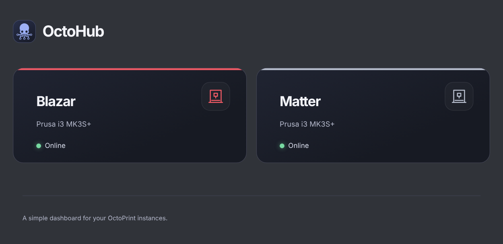

# OctoHub

A tiny landing page for people who run more than one [OctoPrint](https://octoprint.org) instance.

This is not an OctoFarm replacement. There's no backend, no database, and no build step. It's a static page with one config file, in the spirit of [Homer](https://github.com/bastienwirtz/homer).



## Setup

1. Download or clone this repo.
2. Edit `config.yaml` with your printers.
3. Serve the folder with any web server (nginx, Apache, Caddy, Docker, a NAS, a Pi...). For a quick test:

   ```sh
   python3 -m http.server 8080
   ```

   then open <http://localhost:8080>.

To change anything later, edit `config.yaml` and refresh the page.

> **Don't just double-click `index.html`.** Browsers block pages opened from disk from reading `config.yaml`, so it has to be served over http.

## Configuration

```yaml
title: "OctoHub"

status:
  enabled: true
  interval: 30

printers:
  - name: "Blazar"
    model: "Prusa i3 MK3S+"
    url: "http://192.168.0.101"
    color: "#f05a65"

  - name: "Matter"
    model: "Prusa i3 MK3S+"
    url: "http://192.168.0.102"
    color: "#b7becd"
```

| Key | Required | Description |
| --- | --- | --- |
| `title` | no | Page title. Defaults to `OctoHub`. |
| `status.enabled` | no | Show an online/offline indicator on each card. Defaults to `true`. Set `false` to turn it off. |
| `status.interval` | no | Seconds between checks, from 5 to 3600. Defaults to `30`. |
| `printers[].name` | yes | Name shown on the card. |
| `printers[].url` | yes | Where the card links. `http://` is assumed if you leave it off. |
| `printers[].model` | no | Printer model, shown under the name. |
| `printers[].color` | no | Accent color for the card (any CSS color, such as `#f05a65` or `tomato`). Pick something that shows up on a dark background. |

Cards appear in the same order as the list.

**Tip:** the URL can point straight at a tab, for example `http://192.168.0.101/#tab_plugin_dashboard`.

If something in `config.yaml` is wrong (a missing name, a bad URL, a YAML typo), OctoHub shows a message at the top of the page telling you what to fix.

## Status indicator

Each card shows whether its printer can be reached: **Online** (filled green dot) or **Offline** (hollow gray ring). OctoHub checks every 30 seconds while the page is open, and pauses while the tab is hidden.

- It only asks whether anything answers at the card's `url`. It can't tell you whether the printer is connected to OctoPrint, printing, or idle.
- It is read-only and needs no setup: one small `HEAD` request per printer per check. No API key, no CORS setting, and no change to OctoPrint.
- Any HTTP reply counts as reachable, including a login page or a `401`/`403` from a reverse proxy.
- A printer has to miss two checks in a row before it flips from Online to Offline, so one slow reply from a busy Pi doesn't make it look down.
- The check runs in your browser, so it shows what the device you're browsing from can reach.

Use the `status` block in `config.yaml` to change the interval or turn it off.

## Troubleshooting

- **"Could not load config.yaml"**: make sure the file sits next to `index.html` and that you're opening the page through a web server. Some servers (IIS, for example) won't serve `.yaml` files until you add a MIME type for them.
- **"Status unavailable" on a card**: OctoHub is open over `https://` and that printer's `url` starts with `http://`. Browsers block that kind of request. Open OctoHub over `http://`, or give the printer an `https://` address.
- **Every card says Offline, but the printers are fine**: the check runs in your browser, so the printer's address has to work from the device you're browsing on, not just from the server hosting OctoHub. If the card's link doesn't open for you, that's the problem.
- **Red `Failed to load resource` lines in the browser console**: expected when a printer is offline or answers with an error. Browsers log every failed request and a page can't hide them. Set `status.enabled: false` if you don't want the checks at all.

## Maybe later

- Show whether each printer is connected to OctoPrint and what it's doing (state, progress, temperatures) using the OctoPrint API. This needs CORS turned on in OctoPrint and an API key per printer.

## Credits

[js-yaml](https://github.com/nodeca/js-yaml) (MIT) is bundled in `assets/` so the page works on networks with no internet access.

## License

[MIT](LICENSE)
