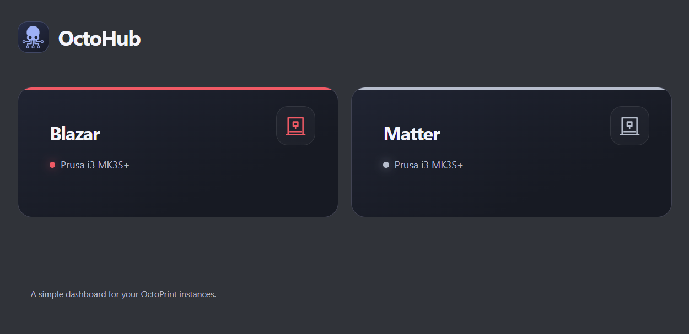

# OctoHub

A tiny landing page for people who run more than one [OctoPrint](https://octoprint.org) instance.

This is not an OctoFarm replacement. There's no backend, no database, and no build step. It's a static page with one config file, in the spirit of [Homer](https://github.com/bastienwirtz/homer).



## Setup

1. Download or clone this repo.
2. Edit `config.yml` with your printers.
3. Serve the folder with any web server (nginx, Apache, Caddy, Docker, a NAS, a Pi...). For a quick test:

   ```sh
   python3 -m http.server 8080
   ```

   then open <http://localhost:8080>.

To change anything later, edit `config.yml` and refresh the page.

> **Don't just double-click `index.html`.** Browsers block pages opened from disk from reading `config.yml`, so it has to be served over http.

## Configuration

```yaml
title: "OctoHub"

printers:
  - name: "Blazar"
    model: "Prusa i3 MK3S+"
    url: "http://192.168.0.101"
    color: "#f05a65"

  - name: "Matter"
    model: "Prusa i3 MK3S+"
    url: "http://192.168.0.102"
    color: "#b7becd"
```

| Key | Required | Description |
| --- | --- | --- |
| `title` | no | Page title. Defaults to `OctoHub`. |
| `printers[].name` | yes | Name shown on the card. |
| `printers[].url` | yes | Where the card links. `http://` is assumed if you leave it off. |
| `printers[].model` | no | Printer model, shown under the name. |
| `printers[].color` | no | Accent color for the card (any CSS color, such as `#f05a65` or `tomato`). Pick something that shows up on a dark background. |

Cards appear in the same order as the list.

**Tip:** the URL can point straight at a tab, for example `http://192.168.0.101/#tab_plugin_dashboard`.

If something in `config.yml` is wrong (a missing name, a bad URL, a YAML typo), OctoHub shows a message at the top of the page telling you what to fix.

## Troubleshooting

- **"Could not load config.yml"**: make sure the file sits next to `index.html` and that you're opening the page through a web server. Some servers (IIS, for example) won't serve `.yml` files until you add a MIME type for them.

## Maybe later

- Show whether each printer is reachable, online, and connected using the OctoPrint API.

## Credits

[js-yaml](https://github.com/nodeca/js-yaml) (MIT) is bundled in `assets/` so the page works on networks with no internet access.
